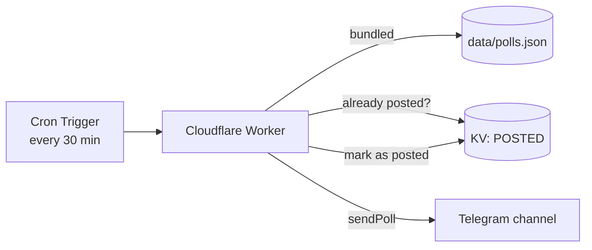

# Andrii Dev — Telegram quiz & poll bot

Posts frontend & AI quizzes and polls from `data/polls.json` to a Telegram channel on schedule.
Runs on Cloudflare Workers with a Cron Trigger: free, on time, no server to look after.

<p align="center">
  
</p>
<p align="center"><sub>Illustration of a posted quiz after a reader answers (sample results).</sub></p>

## How it works



- The Cron Trigger fires every 30 minutes, 09:00–14:30 UTC (11:00–16:30 Kyiv in winter, 12:00–17:30 in summer).
- The Worker picks polls whose `at` time has passed (no more than 3 hours ago) and that aren't in the `POSTED` KV namespace yet.
- It sends them via `sendPoll` and stores each id in KV. No duplicates.
- `data/polls.json` is bundled into the Worker, so editing polls = commit + deploy.

## Setup

1. **Bot**: create it with [@BotFather](https://t.me/BotFather) and add it to the channel as an admin with the "Post messages" permission.
2. **KV namespace**: Cloudflare dashboard → Storage & Databases → KV → Create → name it `polls-bot-posted`. Put its **ID** into `wrangler.toml` (`kv_namespaces.id`) and commit.
   (CLI: `npx wrangler kv namespace create POSTED`.)
3. **Connect the repo**: Workers & Pages → Create → Import a repository → `polls-bot`. Leave the build command empty; the deploy command is `npx wrangler deploy`. Every push to `main` deploys automatically.
4. **Secrets**: Worker → Settings → Variables and Secrets → add as **Secret**:
   - `TELEGRAM_BOT_TOKEN` — the token from BotFather
   - `RUN_TOKEN` — any long random string, protects manual runs
   
   `TELEGRAM_CHAT_ID` (`@andridev`) and `MAX_LATE_HOURS` are plain vars in `wrangler.toml`.
5. **Check it**: open `https://polls-bot.<your-subdomain>.workers.dev/` — you should see `"ok": true` and the next poll.

## Endpoints

| Request | What it does |
| --- | --- |
| `GET /` | Health check: validation status, total polls, the next one |
| `POST /run` | Manual run (header `Authorization: Bearer <RUN_TOKEN>`) |
| `POST /run?dry=1` | Show what would be posted now, without posting |
| `POST /run?dry=1&now=2026-11-21T15:05:00%2B02:00` | Preview any moment |
| `POST /run?maxLate=8` | Post polls missed up to 8 hours ago |

```bash
curl -X POST -H "Authorization: Bearer $RUN_TOKEN" \
  "https://polls-bot.<your-subdomain>.workers.dev/run?dry=1"
```

## `data/polls.json` format

```json
{
  "id": "2026-11-20",
  "at": "2026-11-20T13:00:00+02:00",
  "type": "quiz",
  "question": "Що поверне typeof NaN?",
  "options": ["\"NaN\"", "\"number\"", "\"undefined\"", "\"object\""],
  "correct": 1,
  "explanation": "Так, NaN — це число..."
}
```

- `type`: `quiz` or `regular` (a regular poll has no `correct` or `explanation`)
- `correct`: index of the correct option, zero-based, or an array of indexes for a quiz with several correct answers. Sent as `correct_option_ids` (Bot API 9.6+)
- `at`: always include the UTC offset — `+02:00` in winter, `+03:00` in summer
- Telegram limits: question ≤ 300 chars, option ≤ 100, explanation ≤ 200, 2–10 options. The Worker refuses to post anything if the file is invalid, and the **Validate polls** GitHub Action checks every push.

## Local development

```bash
npm install
npm run check                                        # validate polls.json
NOW=2026-11-21T15:05:00+02:00 npm run check          # preview what is due at that moment
npm run dev                                          # local Worker; trigger cron at /__scheduled
npm run deploy                                       # deploy from your machine
npm run logs                                         # live logs
```

For `npm run dev`, put secrets in `.dev.vars` (git-ignored):

```
TELEGRAM_BOT_TOKEN=...
RUN_TOKEN=...
```

## Notes

- **Missed polls**: a poll not posted within 3 hours of its `at` time is skipped rather than posted late. Change `MAX_LATE_HOURS` or use `/run?maxLate=N`.
- **Free plan** is plenty: ~12 cron runs a day against 100,000 requests and 1,000 KV writes a day.
- **Logs**: Worker → Logs in the dashboard (observability is enabled), or `npm run logs`.
