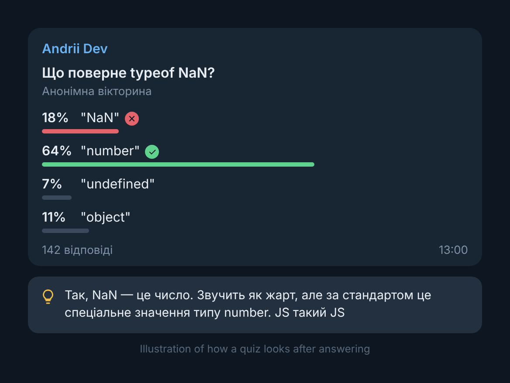
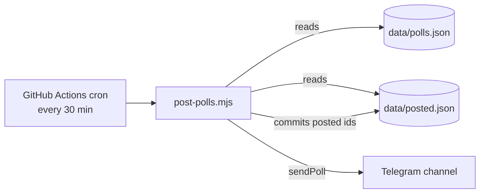
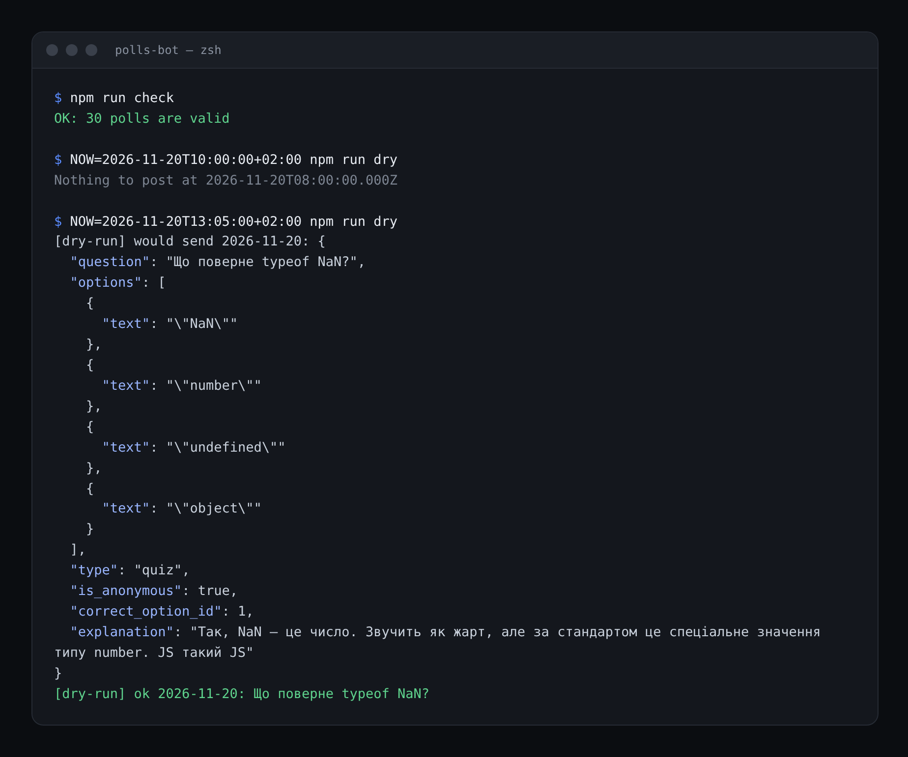

# Andrii Dev — Telegram quiz & poll bot

Posts frontend & AI quizzes and polls from `data/polls.json` to a Telegram channel on schedule.
Runs on GitHub Actions: no server, no dependencies, Node 20+.

<p align="center">
  
</p>
<p align="center"><sub>Illustration of a posted quiz after a reader answers (sample results).</sub></p>

## How it works



- The workflow runs every 30 minutes between 12:00 and 16:30 Kyiv time.
- The script picks polls whose `at` time has already passed (but no more than 3 hours ago) and that are not yet listed in `data/posted.json`.
- It sends them via `sendPoll`, then records their ids in `data/posted.json` and commits the file. No duplicates.

## Setup (~5 min)

1. **Create a bot**: message [@BotFather](https://t.me/BotFather) → `/newbot` → copy the token.
2. **Add the bot to your channel as an admin** with the "Post messages" permission.
3. **Add repository secrets**: Settings → Secrets and variables → Actions → New repository secret
   - `TELEGRAM_BOT_TOKEN` — the token from BotFather
   - `TELEGRAM_CHAT_ID` — `@andridev` (or a numeric chat id)
4. **Allow the workflow to commit**: Settings → Actions → General → Workflow permissions → **Read and write permissions**.
5. **Test it**: Actions → "Post Telegram polls" → Run workflow → `dry_run: true`. The logs show what would be sent.

> Tip: point `TELEGRAM_CHAT_ID` at a private test channel first.

## `data/polls.json` format

```json
{
  "id": "2026-11-20",
  "at": "2026-11-20T13:00:00+02:00",
  "type": "quiz",
  "question": "Що поверне typeof NaN?",
  "options": ["\"NaN\"", "\"number\"", "\"undefined\"", "\"object\""],
  "correct": 1,
  "explanation": "Так, NaN — це число..."
}
```

- `type`: `quiz` or `regular` (a regular poll has no `correct` or `explanation`)
- `correct`: index of the correct option, zero-based
- `at`: always include the UTC offset — `+02:00` in winter, `+03:00` in summer
- Telegram limits: question ≤ 300 chars, option ≤ 100, explanation ≤ 200, 2–10 options. `npm run check` validates all of this, and the workflow sends nothing if the file is invalid.

## Running locally

```bash
npm run check                                      # validate polls.json
NOW=2026-11-20T13:05:00+02:00 npm run dry          # what would be sent at that moment
TELEGRAM_BOT_TOKEN=... TELEGRAM_CHAT_ID=@test npm run post
```



| Env variable | Description |
| --- | --- |
| `TELEGRAM_BOT_TOKEN` | Bot token (required unless `DRY_RUN=1`) |
| `TELEGRAM_CHAT_ID` | `@channel` or numeric chat id (required unless `DRY_RUN=1`) |
| `DRY_RUN=1` | Print payloads, don't call Telegram, don't save state |
| `NOW` | Fake the current time (ISO date), for testing |
| `MAX_LATE_HOURS` | Skip polls older than this many hours (default `3`) |
| `CHECK_ONLY=1` | Only validate `polls.json` |

## Notes

- **Cron delays**: GitHub may start scheduled runs 5–15 minutes late at busy times. Fine for polls.
- **Missed polls**: a poll that couldn't be posted within 3 hours of its `at` time (e.g. Actions outage) is skipped rather than posted late. Tune with `MAX_LATE_HOURS`.
- **Private repo**: ~10 runs/day ≈ 300 of the 2,000 free minutes per month. Public repos are unlimited.
- **Daylight saving time** (from late March): change the cron to `*/30 9-13 * * *` and use `+03:00` in `at`.
- **Inactive repos**: GitHub disables scheduled workflows after 60 days without commits. The bot commits `posted.json` itself, so it stays active while there's something to post.
